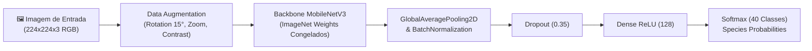

# 🦖 Paleo-Scanner: O Guia Comparativo de Paleo Pines

<div align="center">


<p>Plataforma bio-paleontológica interativa e sistema de visão computacional que atua como <b>ponte entre o universo lúdico do jogo <i>Paleo Pines</i> e a paleontologia fóssil real</b>, contrastando mecânicas de gameplay aconchegantes com evidências anatômicas de museus.</p>

<p>
  <a href="#-execução-rápida-com-docker">Executar via Docker</a> •
  <a href="#-especificações-da-ia-e-treinamento-cnn">Modelo & Treinamento</a> •
  <a href="#-metodologia-e-proveniência-dos-dados">Proveniência dos Dados</a> •
  <a href="docs/model_report.html">Relatório Interativo de IA (HTML)</a> •
  <a href="#-clean-architecture-e-estrutura-em-camadas">Clean Architecture</a>
</p>

</div>

---

## 🌟 O Conceito do Projeto

No jogo de simulação e fazenda ***Paleo Pines***, dinossauros pastam pacificamente, são domesticados através de melodias de flauta, alimentados com guloseimas chamadas *"poppins"* e auxiliam nas tarefas do rancho como regadores, escavadores e montarias velozes.

O **Paleo-Scanner** investiga a biologia por trás dessa fantasia:
1. **Upload de Imagem**: O usuário faz o upload de uma captura de tela do jogo ou seleciona espécimes do catálogo.
2. **Visão Computacional Convolucional**: Uma CNN baseada em **MobileNetV3-Small** com *Transfer Learning* identifica a espécie com **90.60% de acurácia Top-3**.
3. **Core em Clean Architecture**: O motor em **FastAPI** busca os atributos paleontológicos reais curados a partir de holótipos e literatura acadêmica.
4. **Painel Comparativo de Alta Tecnologia**: Interface reativa em **Angular 22** apresentando o tríptico visual (jogo 3D, fóssil de museu e reconstituição em vida), tacômetro circular de fidelidade científica, linha do tempo geológica e régua métrica comparativa humano vs espécime.

---

## 📸 Painel Visual & Demonstração

```
┌────────────────────────────────────────────────────────────────────────┐
│ [DOSSIÊ COMPARATIVO DE ESPÉCIE]              [← Anterior] [Próximo →] [✕] │
│ Spinosaurus (Spinosaurus aegyptiacus)                        #31 / 40  │
├──────────────────────────────────┬─────────────────────────────────────┤
│ 🎮 NO JOGO (PALEO PINES)         │ 🔬 LADO REAL (PALEONTOLOGIA)        │
│                                  │                                     │
│ • Bioma: Veridian Valley (Rios)  │ • Período: Cretáceo Superior        │
│ • Dieta: Carnívoro (Juicy Apium) │ • Datação: ~99 - 93.5 Ma            │
│ • Sociabilidade: Loner           │ • Dimensões: ~14.0 m | ~7.400 kg    │
│ • Habilidade: Waterer & Diver    │ • Anatomia: Focinho cônico, dentes  │
│ • Porte: Grande (Montável)       │   cônicos e vela neural de 1,65 m   │
├──────────────────────────────────┴─────────────────────────────────────┤
│ [TRÍPTICO ANATÔMICO] Modelo 3D (Jogo) | Esqueleto Museu | Paleoarte    │
│ [FIDELIDADE PALEONTOLÓGICA] 96.0% - Alta Precisão de Comportamento     │
└────────────────────────────────────────────────────────────────────────┘
```

---

## 📚 Metodologia e Proveniência dos Dados

Todos os dados e ativos visuais do projeto possuem procedência documentada e transparente:

| Categoria | Origem dos Dados | Métodos de Coleta & Processamento |
|---|---|---|
| **Atributos de Jogo** | *Paleo Pines Community Database* (v3.0.3), Wiki Fandom e Paleo.GG | Coleta estruturada dos biomas, dietas, habilidades de rancho e preferências de poppins das 40 espécies. |
| **Registros Paleontológicos** | *Paleobiology Database (PBDB)*, holótipos de museus e artigos científicos | Curadoria manual de datações radiométricas (Ma), massas estimadas, formações geológicas e adaptações osteológicas. |
| **Retratos In-Game** | Extraídos de capturas oficiais e planilhas de skins de *Paleo Pines* | Tratamento de canal alfa, padronização 256x256 e recorte proporcional de cabeça/busto. |
| **Fotografia Fóssil Real** | *Wikimedia Commons*, *Smithsonian NMNH*, *AMNH*, *National Geographic* | Fotos sob domínio público e Creative Commons de esqueletos reais montados em instituições científicas. |
| **Paleoarte (Vida)** | Acervos científicos abertos e ilustradores paleontológicos | Reconstituições com embasamento anatômico esquelético, musculatura postural e impressões de penas/escamas. |
| **Dataset de Treino da CNN** | 842 imagens curadas divididas em 40 classes (693 treino / 149 validação) | Coletadas de variações cosméticas e skins do jogo, normalizadas em 224x224 RGB com aumento de dados dinâmico. |

---

## 🧠 Especificações da IA e Treinamento (CNN)

O pipeline de inteligência artificial utiliza a biblioteca `tf_keras` sobre **MobileNetV3-Small** com *Transfer Learning*:



### Métricas de Convergência do Modelo v2.0
* **Classes Mapeadas**: **40 espécies biológicas reais** (incluindo *Spinosaurus* e *Sarcosuchus*).
* **Acurácia Top-1 (Validação)**: **77.85%**
* **Acurácia Top-3 (Validação)**: **90.60%**
* **Loss de Validação**: **0.8500** (Categorical Crossentropy com balanceamento de classes)
* **Latência Média de Inferência**: **~35 ms** em CPU
* 📊 **Dashboard Interativo**: Abra [`docs/model_report.html`](docs/model_report.html) no navegador para auditar as métricas, curvas de perda e o catálogo tabular dos 40 neurônios.

---

## 🏛️ Clean Architecture e Estrutura em Camadas

O backend é estritamente desacoplado segundo as diretrizes de Robert C. Martin e Eric Evans (DDD):

### 1. Ordem de Escrita (de dentro pra fora)
| Ordem | Camada | Módulos Reais no Projeto | Responsabilidade |
|---|---|---|---|
| **1** | **Domínio / Entidades & Enums** | `backend/app/core/domain/entities/`<br/>`backend/app/core/domain/enums/` | Entidades puras (`Dinosaur`, `ComparisonReport`, `PredictionResult`). Zero dependências de frameworks. |
| **2** | **Domínio / Gateways (Portas)** | `backend/app/core/domain/gateways/` | Contratos abstratos (`IVisionClassifierGateway`, `IDinosaurRepositoryGateway`). |
| **3** | **Aplicação / Casos de Uso** | `backend/app/core/use_cases/` | Orquestração do caso de uso `ScanDinosaurUseCase` e cálculo do Score de Fidelidade. |
| **4** | **Infraestrutura / Adaptadores** | `backend/app/infrastructure/ml/`<br/>`backend/app/infrastructure/database/` | Implementação com `tf_keras` (`KerasVisionClassifierGateway`) e persistência SQLAlchemy/SQLite. |
| **5** | **Apresentação / Controladores** | `backend/app/presentation/api/v1/` | Endpoints HTTP do FastAPI (`scan.py`, `dinosaurs.py`, `health.py`) e DTOs Pydantic. |

### 2. Ordem de Leitura (de fora pra dentro)
| Ordem | Ponto de Entrada | Camada Subsequente | O que observar |
|---|---|---|---|
| **1** | `backend/app/presentation/api/v1/endpoints/scan.py` | `presentation/schemas/` | Recebimento do upload e validação de MIME types de imagens. |
| **2** | `backend/app/core/use_cases/scan_dinosaur.py` | `core/domain/gateways/` | Orquestração da inferência visual e busca dos atributos paleontológicos. |
| **3** | `backend/app/core/domain/entities/dinosaur.py` | `core/domain/enums/` | A lógica pura do cálculo de fidelidade científica e atributos comparativos. |
| **4** | `backend/app/infrastructure/ml/keras_vision_classifier.py` | `infrastructure/database/` | A execução da CNN e a persistência relacional. |

---

## 🐳 Execução e Deploy com Docker

O projeto oferece suporte tanto para **Container Unificado** (ideal para deploy em nuvem com 1 clique) quanto para **Multi-Container Orquestrado** (ideal para VPS).

### Modalidade A: Container Único de Produção (1-Click Cloud)
Perfeito para plataformas como **Render**, **Hugging Face Spaces**, **Railway** e **Fly.io**:
```bash
# Compilar e executar a aplicação completa na porta 8000
docker build -t paleo-scanner:latest .
docker run -p 8000:8000 paleo-scanner:latest

# Acesse o app completo (Frontend SPA + API + IA) em:
# http://localhost:8000
```

### Modalidade B: Multi-Container Orquestrado (Docker Compose)
Ideal para desenvolvimento modular ou servidores VPS com Nginx dedicado:
```bash
# Na raiz do projeto:
docker compose up --build

# Para customizar portas em caso de conflito, copie o .env.example:
cp .env.example .env
# Altere BACKEND_PORT ou FRONTEND_PORT conforme necessário
```

### Portas e Endpoints
* **Aplicação Completa (Modo Unificado)**: [http://localhost:8000](http://localhost:8000)
* **Frontend Web (Modo Compose / Nginx)**: [http://localhost:4200](http://localhost:4200)
* **Backend API (FastAPI)**: [http://localhost:8000](http://localhost:8000)
* **Documentação Swagger OpenAPI**: [http://localhost:8000/docs](http://localhost:8000/docs)
* **Healthcheck do Backend**: [http://localhost:8000/api/v1/health](http://localhost:8000/api/v1/health)

📘 **Guia Completo de Deploy na Nuvem**: Consulte o passo a passo detalhado para Render, Hugging Face Spaces, Railway e VPS em [`docs/DEPLOYMENT_GUIDE.md`](docs/DEPLOYMENT_GUIDE.md).

---

## 💻 Execução Local (Ambiente de Desenvolvimento)

### 1. Backend (Python 3.11+)
```bash
cd paleo-scanner
python3 -m venv .venv
source .venv/bin/activate
pip install -r backend/requirements.txt

# Iniciar servidor ASGI
cd backend
python -m uvicorn app.main:app --host 127.0.0.1 --port 8000 --reload
```

### 2. Frontend (Node 20+ / Angular 22)
```bash
cd paleo-scanner/frontend
npm install
npm start
# Acessar em http://localhost:4200
```

---

## 🧪 Suíte de Testes Automatizados

O ecossistema é 100% coberto por testes automatizados de unidade, integração e contratos:

```bash
# Testes do Backend (FastAPI + Clean Arch) - 19/19 testes
pytest backend/tests

# Testes do Frontend (Angular 22 + Vitest) - 23/23 testes
cd frontend && npm test -- --watch=false

# Build de Produção do Frontend
cd frontend && npm run build
```

---

## 📁 Estrutura de Diretórios do Monorepo

```
paleo-scanner/
├── backend/                          # Backend FastAPI em Clean Architecture
│   ├── app/
│   │   ├── core/                     # Regras de Negócio e Domínio Puro
│   │   │   ├── domain/               # Entidades, Enums e Gateways Abstratos
│   │   │   └── use_cases/            # Casos de Uso (ScanDinosaur, CompareSpecies)
│   │   ├── infrastructure/           # Adaptadores Tecnológicos (Keras, SQLite)
│   │   │   ├── database/             # SQLite, Models SQLAlchemy, Seeds das 40 espécies
│   │   │   └── ml/                   # Implementação do KerasVisionClassifier
│   │   ├── presentation/             # Endpoints REST e Schemas Pydantic
│   │   └── static/                   # Assets servidos com cabeçalhos No-Cache
│   ├── tests/                        # 19 testes automatizados com Pytest
│   ├── Dockerfile                    # Container Docker do Backend
│   └── requirements.txt              # Dependências Python
├── frontend/                         # Frontend SPA em Angular 22 + Tailwind
│   ├── src/app/
│   │   ├── core/                     # Serviços de Estado Reativo (ScannerStateService)
│   │   ├── features/
│   │   │   ├── scanner/              # Zona de Upload com drag & drop e scanline
│   │   │   ├── comparison/           # Painel Split-View, Tríptico e Escala
│   │   │   └── catalog/              # Catálogo com busca e navegação por teclado
│   │   └── shared/                   # Componentes reutilizáveis (Badges, Header)
│   ├── nginx.conf                    # Configuração de Proxy Reverso e SPA
│   ├── Dockerfile                    # Container Multi-stage (Node Build -> Nginx)
│   └── package.json                  # Dependências e scripts npm
├── ml/                               # Pipeline de Machine Learning
│   ├── data/                         # Datasets de treino/validação (842 amostras)
│   ├── models/                       # Modelo compilado .keras e class_indices.json
│   └── train.py                      # Pipeline de treino com Data Augmentation
├── docs/                             # Documentação técnica e relatórios
│   ├── model_report.html             # Relatório Interativo do Modelo e Dataset
│   ├── ARCHITECTURE.md               # Detalhes de Clean Arch e inversão de controle
│   ├── PALEO_DATABASE_SPEC.md        # Especificação taxonômica das 40 espécies
│   └── DATASET_GUIDELINES.md         # Diretrizes de visão computacional
├── docker-compose.yml                # Orquestrador multi-container de produção
└── README.md                         # Documentação principal
```

---

## 📄 Licença

Distribuído sob a licença **MIT**. Consulte `LICENSE` para mais detalhes.
Desenvolvido por **Elynne Lima** — *AI Systems Engineer & Full-Stack Architect*.
