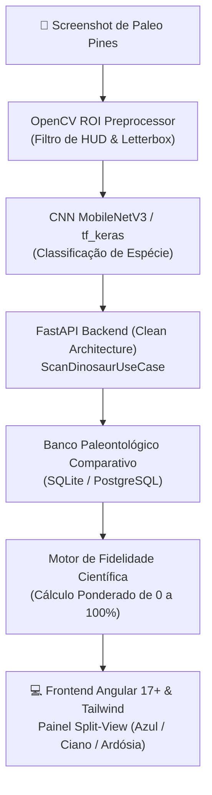

# 🦖 Paleo-Scanner: O Guia Comparativo de Paleo Pines

<div align="center">


<p>Plataforma enciclopédica interativa e sistema de visão computacional que atua como <b>ponte entre o universo lúdico do jogo <i>Paleo Pines</i> e a paleontologia fóssil real</b>, contrastando mitos aconchegantes com evidências científicas.</p>

</div>

---

## 🌟 O Conceito do Projeto

No aconchegante jogo de fazenda ***Paleo Pines***, dinossauros pastam pacificamente, são encantados por melodias de flauta, adoram doces chamados *"poppins"* e ajudam a regar hortas e quebrar pedregulhos. 

Mas como esses animais realmente viviam? O que fósseis de 70 milhões de anos nos contam sobre sua verdadeira alimentação, dimensões e comportamento?

O **Paleo-Scanner** resolve essa curiosidade com inteligência artificial:
1. O usuário faz o upload de uma captura de tela do jogo.
2. Uma **Rede Neural Convolucional (CNN)** treinada com `tf_keras` identifica a espécie do dinossauro.
3. O motor em **FastAPI (Clean Architecture & DDD)** correlaciona os registros do jogo com a base paleontológica real.
4. Uma interface moderna em **Angular 17+** exibe um painel comparativo lado a lado (*Split-View*) com o **Índice de Fidelidade Científica**.

---

## 🏗️ Topologia da Arquitetura



---

## 🏛️ Clean Architecture: Estrutura em Camadas

O backend é estritamente desacoplado em camadas concêntricas segundo Robert C. Martin e Eric Evans (DDD):

### 1. Ordem de Escrita (de dentro pra fora)

| Ordem | Camada | Módulo / Arquivos | Justificativa Arquitetural |
|---|---|---|---|
| **1** | **Domínio / Entidades & Enums** | `core/domain/entities/dinosaur.py`<br/>`core/domain/enums/poppin_flavor.py` | Regras essenciais do negócio e modelos de dados imutáveis. Não dependem de bibliotecas externas, frameworks ou bancos. |
| **2** | **Domínio / Gateways (Portas)** | `core/domain/gateways/vision_gateway.py`<br/>`core/domain/gateways/dinosaur_repository.py` | Contratos abstratos (`ABC`) que estipulam como o domínio se comunica com inferência de ML e bancos de dados. |
| **3** | **Aplicação / Casos de Uso** | `core/use_cases/scan_dinosaur.py`<br/>`core/use_cases/compare_species.py` | Orquestração do fluxo de execução puro, independente de protocolo de transporte (HTTP/CLI). |
| **4** | **Infraestrutura / Adaptadores** | `infrastructure/ml/keras_classifier.py`<br/>`infrastructure/database/sqlite_repository.py` | Implementações tecnológicas concretas (`tf_keras`, OpenCV, SQLAlchemy). Detalhes que dependem do domínio. |
| **5** | **Apresentação / Controladores** | `presentation/api/v1/endpoints/scan.py`<br/>`presentation/schemas/scan_dto.py` | Rotas FastAPI, validação Pydantic de requisições multipart e documentação OpenAPI. |

### 2. Ordem de Leitura (de fora pra dentro)

| Ordem | Ponto de Entrada | Camada Subsequente | O que observar |
|---|---|---|---|
| **1** | `presentation/api/v1/endpoints/scan.py` | `presentation/schemas/` | Recebimento do upload e validação de MIME types de imagens. |
| **2** | `core/use_cases/scan_dinosaur.py` | `core/domain/gateways/` | Orquestração da inferência visual e busca dos atributos paleontológicos. |
| **3** | `core/domain/entities/dinosaur.py` | `core/domain/enums/` | A lógica pura do cálculo de fidelidade científica e atributos comparativos. |
| **4** | `infrastructure/ml/keras_classifier.py` | `infrastructure/database/` | A execução da CNN e a persistência relacional. |

---

## 🎨 Interface Visual (Angular 17+ & Tailwind CSS)

A experiência visual adota um tema escuro imersivo (*Deep Dark Mode*) com realces em **Ciano Elétrico** (`#06b6d4`), **Azul Cobalto** (`#2563eb`) e **Âmbar Fóssil** (`#f59e0b`):

* **Painel Split-View**:
  * **Lado Esquerdo (*Paleo Pines*)**: Card aconchegante com ícones do bioma de amizade, sabor do poppin preferido, sela de montaria e habilidade na fazenda.
  * **Lado Direito (*Fóssil Real*)**: Card de museu paleontológico com família taxonômica, formação geológica, massa estimada em toneladas e dieta fóssil.
  * **Gauge Central**: Indicador gráfico do Score de Fidelidade Científica com justificativa biológica explicativa.

---

## 📊 Matriz Comparativa (Amostra Inicial)

| Espécie | Bioma (*Paleo Pines*) | Poppin Favorito | Período Geológico Real | Dieta Comprovada por Fósseis | Fidelidade |
| :--- | :--- | :--- | :--- | :--- | :---: |
| **Parasaurolophus** | Veridian Valley | Doce / Suculento | Cretáceo Superior (~75 Ma) | Herbívoro estrito (folhas lenhosas) | **78%** |
| **Gallimimus** | Dapplewood | Crocante | Cretáceo Superior (~70 Ma) | Onívoro / Filtrador de bico córneo | **82%** |
| **Triceratops** | Veridian Valley | Suculento | Cretáceo Superior (~68 Ma) | Herbívoro fibroso (palmeiras e cicas) | **85%** |
| **Ankylosaurus** | Ariacotta Dunes | Picante | Cretáceo Superior (~68 Ma) | Herbívoro generalista (folhas e tubérculos) | **80%** |
| **Deinocheirus** | Veridian Valley | Refrescante | Cretáceo Superior (~70 Ma) | Onívoro aquático / Piscívoro de pântano | **88%** |

---

## 📚 Documentação Técnica Aprofundada

* 🏛️ [Arquitetura do Sistema e Inversão de Dependências](file:///Users/elyyihz/repositories/personal/paleo-scanner/docs/ARCHITECTURE.md)
* 🦴 [Especificação da Base de Dados Paleontológica](file:///Users/elyyihz/repositories/personal/paleo-scanner/docs/PALEO_DATABASE_SPEC.md)
* 📸 [Diretrizes do Dataset de Imagens & CNN tf_keras](file:///Users/elyyihz/repositories/personal/paleo-scanner/docs/DATASET_GUIDELINES.md)

---

## 🚀 Como Executar

### Pré-requisitos
* Python 3.11+
* Node.js 18+ & Angular CLI 17+
* Docker & Docker Compose (opcional)

### 1. Execução via Docker Compose
```bash
docker compose up --build
```
Acesse o frontend em `http://localhost:4200` e a documentação da API em `http://localhost:8000/docs`.

### 2. Desenvolvimento Local do Backend
```bash
cd backend
python -m venv .venv
source .venv/bin/activate
pip install -r requirements.txt
uvicorn app.main:app --reload --port 8000
```

---

## 📄 Licença

Distribuído sob a licença **MIT**. Veja `LICENSE` para mais informações.
