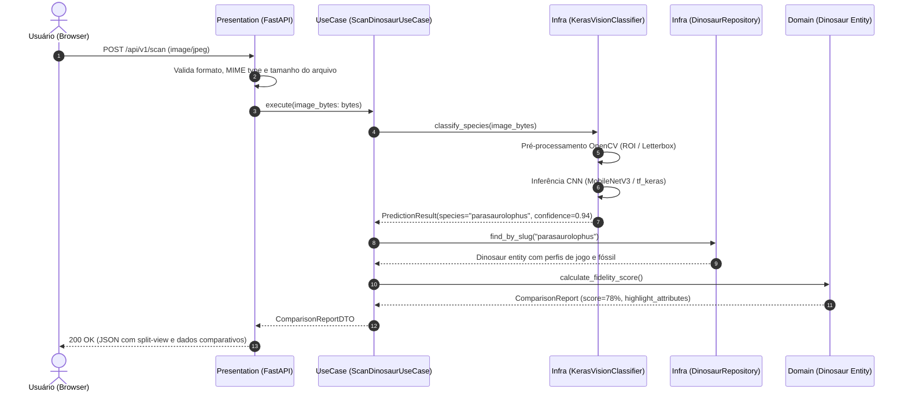

# 🏛️ Arquitetura do Sistema & Decisões Técnicas (Paleo-Scanner)

Este documento descreve detalhadamente a arquitetura do **Paleo-Scanner**, demonstrando a aplicação estrita de **Clean Architecture**, **Domain-Driven Design (DDD)** e desacoplamento de dependências.

---

## 🎯 Princípios Norteadores

1. **Independência de Frameworks**: As regras de negócio e os cálculos paleontológicos residem no núcleo do domínio e não dependem de FastAPI, SQLAlchemy, Keras ou qualquer driver externo.
2. **Inversão de Dependências (DIP)**: Módulos de alto nível não dependem de módulos de baixo nível; ambos dependem de abstrações (Gateways / Interfaces).
3. **Testabilidade Isolada**: Casos de uso podem ser testados com 100% de cobertura unitária sem banco de dados, sem inicializar servidor HTTP e sem carregar pesos de redes neurais pesadas na memória.
4. **Single Source of Truth**: Os atributos do jogo e da paleontologia real formam um agregado consistente governado pela entidade `Dinosaur`.

---

## 🧩 Diagrama de Camadas (Clean Architecture)

```
       +--------------------------------------------------------+
       |                  Presentation Layer                    |
       |  - FastAPI Endpoints (/scan, /dinosaurs, /compare)     |
       |  - DTOs / Schemas Pydantic v2                          |
       +--------------------------------------------------------+
                                  |
                                  v
       +--------------------------------------------------------+
       |                   Application Layer                    |
       |  - ScanDinosaurUseCase (Orquestra ML + DB + Score)     |
       |  - CompareSpeciesUseCase (Gera split-view)             |
       |  - ListCatalogUseCase (Filtro por bioma/período)       |
       +--------------------------------------------------------+
                                  |
                                  v
       +--------------------------------------------------------+
       |                     Domain Layer                       |
       |  - Entities: Dinosaur, PaleoPinesProfile, FossilSpec   |
       |  - Enums: BiomeType, PoppinFlavor, GeologicalPeriod    |
       |  - Gateways: IVisionClassifier, IDinosaurRepository    |
       +--------------------------------------------------------+
                                  ^
                                  |
       +--------------------------------------------------------+
       |                  Infrastructure Layer                  |
       |  - KerasVisionClassifier (tf_keras / ONNX Runtime)     |
       |  - SQLiteDinosaurRepository (SQLAlchemy / Seeders)     |
       |  - OpenCVImagePreprocessor (Crop & Resize)             |
       +--------------------------------------------------------+
```

---

## 🔄 Fluxo de Execução: Upload e Classificação

O diagrama de sequência abaixo demonstra como uma requisição de upload transita pelas 4 camadas:



---

## 📦 Definição dos Gateways do Domínio

As portas (*ports*) que o domínio expõe para serem implementadas pela infraestrutura:

```python
from abc import ABC, abstractmethod
from typing import Optional, List
from app.core.domain.entities.dinosaur import Dinosaur
from app.core.domain.entities.prediction import PredictionResult

class IVisionClassifierGateway(ABC):
    """Interface abstrata para inferência visual da espécie."""
    
    @abstractmethod
    def classify_image(self, image_bytes: bytes) -> PredictionResult:
        """Classifica os bytes da imagem retornando a espécie inferida e a confiança."""
        pass


class IDinosaurRepositoryGateway(ABC):
    """Interface abstrata para persistência e consulta paleontológica."""
    
    @abstractmethod
    def find_by_slug(self, slug: str) -> Optional[Dinosaur]:
        """Recupera um dinossauro pelo slug unificado (ex: 'parasaurolophus')."""
        pass

    @abstractmethod
    def list_all(self, biome: Optional[str] = None, period: Optional[str] = None) -> List[Dinosaur]:
        """Lista espécies com suporte a filtros combinados."""
        pass
```

---

## 🛡️ Tratamento de Erros e Resiliência

1. **Baixa Confiança na Inferência (`confidence < 0.60`)**:
   * O caso de uso retorna um status `uncertain_prediction` alertando o usuário e sugerindo as 3 espécies candidatas mais próximas com base na distribuição softmax.
2. **Formato de Imagem Inválido**:
   * O middleware de apresentação valida assinaturas mágicas de bytes (JPEG, PNG, WebP) antes de submeter ao interpretador de ML, impedindo estouros de memória.
3. **Fallback e Modo Stub**:
   * Para ambientes de desenvolvimento e CI sem GPU ou com modelo em treinamento, o `MockVisionClassifierGateway` simula predições determinísticas baseadas em nomes de arquivos ou hashes.
