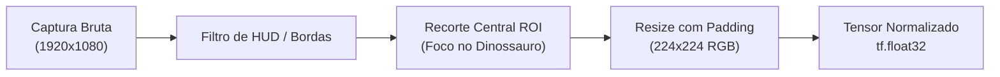

# 📸 Diretrizes do Dataset de Visão Computacional (Paleo-Scanner)

Este documento orienta a coleta, curadoria, rotulagem e estratégias de *Data Augmentation* para o treinamento da rede neural convolucional (**CNN**) com `tf_keras` responsável pela classificação das espécies do jogo *Paleo Pines*.

---

## 🎯 Objetivo do Classificador

Reconhecer com acurácia superior a **85%** a espécie do dinossauro a partir de uma captura de tela enviada pelo usuário, mesmo sob variações de iluminação in-game (manhã, tarde, chuva), ângulos de câmera e diferentes colorações/padrões de pele cosméticos do jogo.

---

## 📂 Estrutura de Diretórios do Dataset

O repositório adota a estrutura canônica esperada por geradores de dataset do TensorFlow/Keras:

```
ml/data/
├── raw/                              # Capturas originais sem corte (Full HD / 4K)
├── processed/
│   ├── train/                        # 70% dos dados para treinamento
│   │   ├── ankylosaurus/
│   │   ├── carnotaurus/
│   │   ├── deinocheirus/
│   │   ├── gallimimus/
│   │   ├── parasaurolophus/
│   │   ├── psittacosaurus/
│   │   ├── stegosaurus/
│   │   ├── therizinosaurus/
│   │   ├── triceratops/
│   │   └── velociraptor/
│   ├── val/                          # 15% para validação durante épocas
│   │   └── [mesmas classes]
│   └── test/                         # 15% para avaliação cega de generalização
│       └── [mesmas classes]
```

---

## 📐 Especificações de Imagem & Pré-processamento

1. **Resolução de Entrada da Rede**: `224 x 224 x 3` (RGB).
2. **Normalização de Pixels**: Escala normalizada para o intervalo `[0, 1]` ou `[-1, 1]` (dependendo do backbone MobileNetV3/EfficientNet).
3. **Extração de Região de Interesse (ROI)**:
   * A screenshot enviada pelo usuário geralmente inclui a barra de ferramentas inferior, indicador de hora/dia e elementos de cenário.
   * O pipeline de pré-processamento aplica detecção de contornos ou recorte central ponderado (*Saliency Crop*) para remover artefatos de interface gráfica antes da alimentação dos tensores.



---

## 🧪 Estratégia de Data Augmentation

Para mitigar overfitting com datasets reduzidos, aplicamos transformações dinâmicas via camadas do Keras (`tf_keras.layers`):

```python
import tf_keras as keras
from tf_keras import layers

data_augmentation = keras.Sequential([
    layers.RandomFlip("horizontal"),
    layers.RandomRotation(0.08),       # Rotações leves de até +/- 15 graus
    layers.RandomZoom(0.1),            # Zoom in/out de até 10%
    layers.RandomBrightness(0.15),     # Simular variações climáticas in-game
    layers.RandomContrast(0.1),
], name="dino_augmentation_layer")
```

---

## 🧠 Arquitetura do Modelo Recomendada

Para inferência veloz tanto em CPU de servidor quanto em containers leves, utilizamos **Transfer Learning**:

* **Backbone**: `MobileNetV3Small` ou `EfficientNetB0` pré-treinado no ImageNet.
* **Camada de Adaptação**:
  * `GlobalAveragePooling2D()`
  * `BatchNormalization()`
  * `Dropout(0.3)`
  * `Dense(128, activation='relu')`
  * `Dense(num_classes, activation='softmax')`
* **Otimizador**: Adam com *Learning Rate Decay* (`lr=1e-3` na fase inicial, `1e-4` no fine-tuning dos blocos finais).
* **Função de Perda**: `CategoricalCrossentropy()`.

---

## 📊 Critérios de Avaliação & Exportação

* **Métrica Principal**: Acurácia Top-1 no conjunto de teste > 85%.
* **Métrica Secundária**: Macro F1-score > 0.80 para assegurar que espécies menores (ex: *Psittacosaurus*) não sejam ofuscadas por gigantes.
* **Formato de Exportação**:
  * `model_dino_classifier.keras` (formato nativo Keras v3)
  * `model_dino_classifier.onnx` (otimizado para inferência rápida com ONNX Runtime no backend FastAPI).
