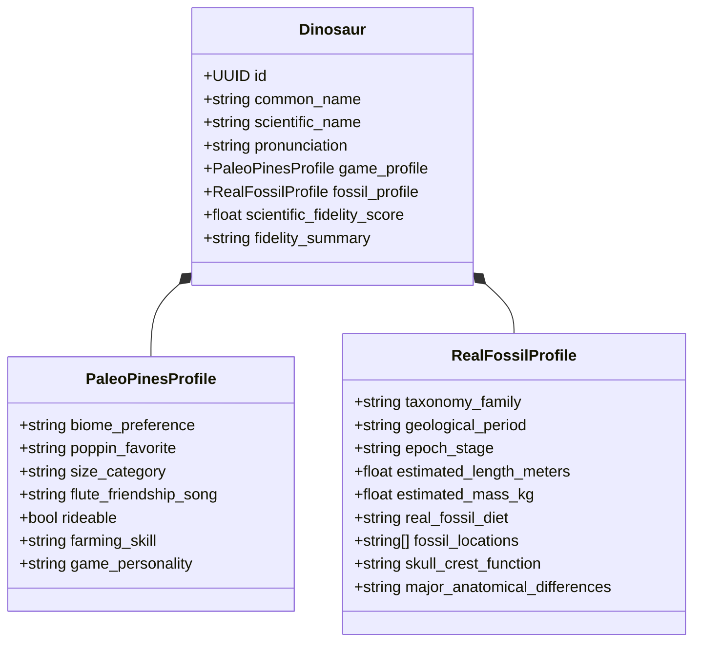

# 🦴 Especificação da Base de Dados Paleontológica Comparativa (Paleo-Scanner)

Este documento define a taxonomia, as regras de dados e o catálogo inicial de espécies do **Paleo-Scanner**, contrastando os dados do jogo *Paleo Pines* com as evidências paleontológicas fósseis do mundo real.

---

## 🏛️ Entidades & Esquema de Dados

---

## 🧮 Fórmula do Score de Fidelidade Científica (0 a 100%)

O índice pondera 4 dimensões científicas contrastadas com o gameplay lúdico:
1. **Dieta & Dentição (30%)**: Correspondência entre o gosto alimentar no jogo e a mecânica mandibular/coprólitos reais.
2. **Dimensões & Proporções (25%)**: Proporção anatômica (ex: tamanho da cabeça, bipedismo/quadrupedismo, escala do crânio).
3. **Bioma & Paleoclima (25%)**: Consistência entre a flora do vale do jogo e o paleoclima da formação geológica do fóssil.
4. **Comportamento Social & Gregário (20%)**: Evidência fóssil de manadas, ninhos comunais e cuidado parental vs. o sistema de amizade do jogo.

---

## 🦕 Catálogo Inicial de Espécies Mapeadas

### 1. Parasaurolophus (*Parasaurolophus walkeri*)
* **🎮 Paleo Pines**:
  * **Bioma**: Veridian Valley (Vales floridos e pradarias amenas).
  * **Poppin Favorito**: Doce / Suculento (Sweet / Juicy).
  * **Porte**: Grande (Montaria rápida com sela).
  * **Habilidade**: Limpar detritos e regar plantações em área.
  * **Personalidade**: Afetuoso e curioso.
* **🔬 Paleontologia Real**:
  * **Família**: Hadrosauridae (dinossauro bico-de-pato).
  * **Período**: Cretáceo Superior (Campaniano, ~76.5 a 73 milhões de anos).
  * **Tamanho**: 9,5 a 10 metros de comprimento | **Massa**: ~2.500 kg.
  * **Localização**: Formação Dinosaur Park (Canadá) e Formação Kaiparowits (EUA).
  * **Dieta Real**: Herbívoro estrito (folhas duras, agulhas de coníferas e vegetação lenhosa triturada por baterias dentárias).
  * **Função da Crista**: Tubo oco resonador para comunicação acústica intraespecífica de baixa frequência e exibição visual.
  * **Score de Fidelidade**: **78%** *(Excelente representação do porte gregário; adaptação dócil lúdica)*.

---

### 2. Gallimimus (*Gallimimus bullatus*)
* **🎮 Paleo Pines**:
  * **Bioma**: Dapplewood (Florestas úmidas e densas).
  * **Poppin Favorito**: Crocante (Crunchy).
  * **Porte**: Médio (Montaria leve).
  * **Habilidade**: Colhedor ágil de sementes e frutas silvestres.
  * **Personalidade**: Arisco, extremamente veloz.
* **🔬 Paleontologia Real**:
  * **Família**: Ornithomimidae ("imitadores de pássaros").
  * **Período**: Cretáceo Superior (Maastrichtiano, ~70 milhões de anos).
  * **Tamanho**: 6 metros de comprimento | **Massa**: ~450 kg.
  * **Localização**: Formação Nemegt (Deserto de Gobi, Mongólia).
  * **Dieta Real**: Onívoro / filtrador (bico córneo edêntulo para filtrar pequenos invertebrados, plantas aquáticas e ovos).
  * **Locomoção**: Cursor de alta velocidade (estimativas de até 55 km/h devido à tíbia alongada).
  * **Score de Fidelidade**: **82%** *(Reflete com grande precisão a agilidade e bipedismo ornitomimídeo)*.

---

### 3. Triceratops (*Triceratops horridus*)
* **🎮 Paleo Pines**:
  * **Bioma**: Veridian Valley & Dapplewood.
  * **Poppin Favorito**: Suculento / Terroso.
  * **Porte**: Grande (Montaria pesada).
  * **Habilidade**: Quebrador de pedregulhos e troncos grandes.
  * **Personalidade**: Protetor e territorial.
* **🔬 Paleontologia Real**:
  * **Família**: Ceratopsidae.
  * **Período**: Cretáceo Superior final (~68 a 66 milhões de anos).
  * **Tamanho**: 8 a 9 metros de comprimento | **Massa**: 6.000 a 9.000 kg.
  * **Localização**: Formação Hell Creek (EUA).
  * **Dieta Real**: Herbívoro de vegetação rasteira e fibrosa (palmeiras, cicadáceas e samambaias arrancadas com bico corneo cortante).
  * **Estrutura Craniana**: Folho ósseo maciço (sem fenestras parietais) e três chifres usados para defesa contra *Tyrannosaurus rex* e combate intraespecífico.
  * **Score de Fidelidade**: **85%** *(Mecânica de demolição condizente com a robustez biomecânica do crânio fóssil)*.

---

### 4. Ankylosaurus (*Ankylosaurus magniventris*)
* **🎮 Paleo Pines**:
  * **Bioma**: Ariacotta Dunes (Regiões secas e semiáridas).
  * **Poppin Favorito**: Picante / Crocante (Spicy / Crunchy).
  * **Porte**: Médio-Grande (Tanque dócil).
  * **Habilidade**: Compactar solo e quebrar minérios raros com a cauda em clava.
* **🔬 Paleontologia Real**:
  * **Família**: Ankylosauridae.
  * **Período**: Cretáceo Superior final (~68 a 66 milhões de anos).
  * **Tamanho**: 6 a 8 metros de comprimento | **Massa**: 4.800 a 8.000 kg.
  * **Localização**: Formação Hell Creek e Lance (EUA/Canadá).
  * **Dieta Real**: Herbívoro generalista não-seletivo (frutos caídos, folhas macias e tubérculos).
  * **Armadura**: Osteodermas fusionadas cobrindo dorso, pescoço e pálpebras; cauda terminada em clava óssea capaz de fraturar membros de predadores.
  * **Score de Fidelidade**: **80%** *(Uso da cauda em clava no jogo espelha fielmente a biomecânica defensiva)*.

---

### 5. Stegosaurus (*Stegosaurus stenops*)
* **🎮 Paleo Pines**:
  * **Bioma**: Dapplewood.
  * **Poppin Favorito**: Terroso / Doce.
  * **Porte**: Grande.
  * **Habilidade**: Cortar vegetação densa e arar terra em fileiras.
* **🔬 Paleontologia Real**:
  * **Família**: Stegosauridae.
  * **Período**: Jurássico Superior (Kimmeridgiano ao Titoniano, ~155 a 150 milhões de anos).
  * **Tamanho**: 9 metros de comprimento | **Massa**: ~3.500 kg.
  * **Localização**: Formação Morrison (EUA) e Portugal.
  * **Dieta Real**: Herbívoro de estrato baixo (musgos, fetos e cicas com dentição simples em folha).
  * **Placas e Espigões**: Placas dérmicas dorsais vascularizadas (termorregulação e exibição social); 4 espigões caudais (thagomizer) usados em defesa ativa contra *Allosaurus*.
  * **Score de Fidelidade**: **76%** *(No jogo o animal é contemporâneo de espécies do Cretáceo, uma anacronia lúdica proposital)*.

---

### 6. Velociraptor (*Velociraptor mongoliensis*)
* **🎮 Paleo Pines**:
  * **Bioma**: Ariacotta Dunes.
  * **Poppin Favorito**: Carnoso / Picante (adaptado para guloseima do jogo).
  * **Porte**: Pequeno (Companheiro de caminhada rápida).
  * **Habilidade**: Farejador de sementes enterradas e itens ocultos.
* **🔬 Paleontologia Real**:
  * **Família**: Dromaeosauridae.
  * **Período**: Cretáceo Superior (~75 a 71 milhões de anos).
  * **Tamanho**: 2 metros de comprimento (da ponta do focinho à cauda), ~0,5m de altura no quadril | **Massa**: ~15 a 20 kg.
  * **Localização**: Formação Djadochta (Gobi, Mongólia).
  * **Penas**: Fósseis com papilas ulnares comprovam presença inequívoca de penas desenvolvidas nos braços e cauda.
  * **Garra Falciforme**: Segundo dedo do pé com garra curva hipertrofiada usada para prender presas no chão (*Raptor Prey Restraint*).
  * **Score de Fidelidade**: **72%** *(O jogo acerta no tamanho reduzido real — diferente de Jurassic Park —, mas estiliza a plumagem)*.

---

### 7. Deinocheirus (*Deinocheirus mirificus*)
* **🎮 Paleo Pines**:
  * **Bioma**: Veridian Valley (margens de rios e pântanos).
  * **Poppin Favorito**: Suculento / Refrescante.
  * **Porte**: Gigante.
  * **Habilidade**: Pesca e limpeza de canais fluviais.
* **🔬 Paleontologia Real**:
  * **Família**: Deinocheiridae.
  * **Período**: Cretáceo Superior (~70 milhões de anos).
  * **Tamanho**: 11 metros de comprimento | **Massa**: ~6.400 kg.
  * **Localização**: Formação Nemegt (Mongólia).
  * **Morfologia Única**: Bico largo de pato, corcunda óssea dorsal sustentada por espinhas neurais e braços gigantes de 2,4 metros com garras rombas.
  * **Dieta Real**: Onívoro aquático / piscívoro (gastrolitos e restos de escamas de peixes encontrados na cavidade estomacal do holótipo).
  * **Score de Fidelidade**: **88%** *(Altíssima fidelidade ao habitat de áreas alagadas e hábito alimentar comprovado por fósseis)*.

---

### 8. Carnotaurus (*Carnotaurus sastrei*)
* **🎮 Paleo Pines**:
  * **Bioma**: Ariacotta Dunes.
  * **Poppin Favorito**: Picante.
  * **Porte**: Grande.
  * **Habilidade**: Velocidade extrema de corrida e proteção de rebanhos.
* **🔬 Paleontologia Real**:
  * **Família**: Abelisauridae.
  * **Período**: Cretáceo Superior (~71 a 69 milhões de anos).
  * **Tamanho**: 7,5 a 9 metros de comprimento | **Massa**: ~1.500 a 2.000 kg.
  * **Localização**: Formação La Colonia (Patagônia, Argentina).
  * **Anatomia**: Crânio curto e alto com chifres frontais proeminentes; membros anteriores vestigiais minúsculos (menores que os do *T. rex*); cauda com vértebras caudais adaptadas para o músculo *caudofemoralis longus*, tornando-o o grande terópode mais veloz conhecido.
  * **Score de Fidelidade**: **84%** *(A habilidade de arrancada no jogo homenageia a biomecânica real do caudofemoralis)*.

---

### 9. Therizinosaurus (*Therizinosaurus cheloniformis*)
* **🎮 Paleo Pines**:
  * **Bioma**: Dapplewood.
  * **Poppin Favorito**: Frutado / Doce.
  * **Porte**: Grande.
  * **Habilidade**: Podar árvores altas e colher frutas no topo de copas.
* **🔬 Paleontologia Real**:
  * **Família**: Therizinosauridae.
  * **Período**: Cretáceo Superior (~70 milhões de anos).
  * **Tamanho**: 10 metros de comprimento | **Massa**: ~5.000 kg.
  * **Localização**: Formação Nemegt (Mongólia).
  * **Garras Gigantescas**: Garras nas mãos de até 1 metro de comprimento, achatadas lateralmente; dentes minúsculos em folha para ceifar folhagens altas.
  * **Score de Fidelidade**: **87%** *(O jogo traduz com grande precisão a função biológica de colheita arbórea das garras gigantes)*.

---

### 10. Psittacosaurus (*Psittacosaurus mongoliensis*)
* **🎮 Paleo Pines**:
  * **Bioma**: Veridian Valley.
  * **Poppin Favorito**: Sementes / Crocante.
  * **Porte**: Muito Pequeno (Pet dócil).
  * **Habilidade**: Encontrar mudas raras.
* **🔬 Paleontologia Real**:
  * **Família**: Psittacosauridae.
  * **Período**: Cretáceo Inferior (~126 a 101 milhões de anos).
  * **Tamanho**: 1 a 2 metros | **Massa**: ~20 kg.
  * **Localização**: Formação Yixian (China) e Mongólia.
  * **Bico e Cerdas**: Bico semelhante ao de papagaio para quebrar nozes e sementes duras; fileira de cerdas tegumentares filamentosas na cauda preservadas em espécimes de Liaoning.
  * **Score de Fidelidade**: **89%** *(O jogo captura o porte minúsculo, o bico quebra-nozes e a dieta à base de sementes)*.
